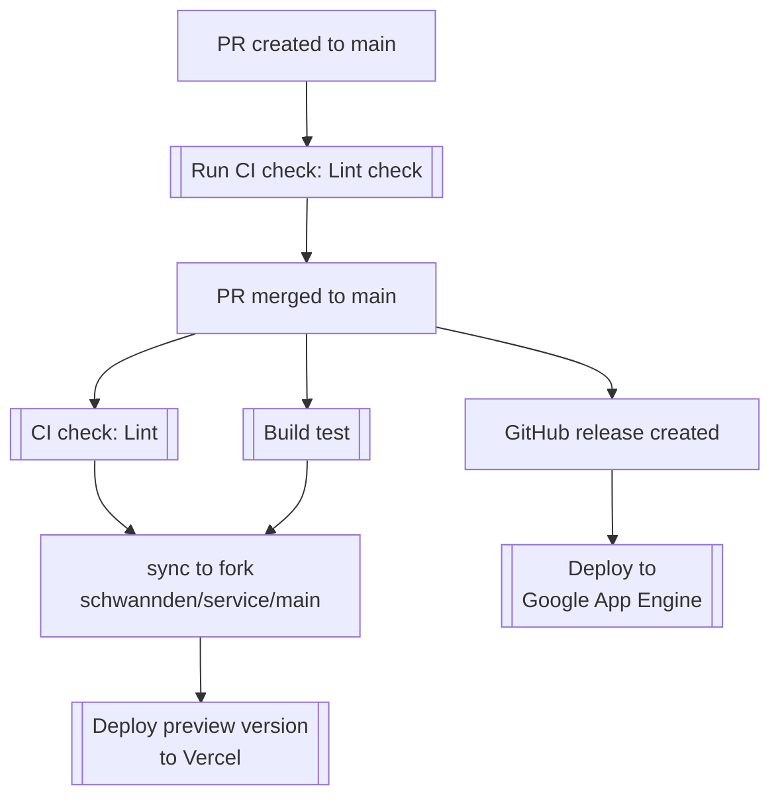

# 萬隆基督的教會服事表

## 開啟專案

安裝相關依賴，開啟開發伺服器

```bash
$ npm install
$ npm run prepare
$ cp .env.local.template .env.local
# 編輯 .env.local：填入 GOOGLE_PRIVATE_KEY，並刪除兩行表單 ID（見下方說明）
$ npm run dev
```

Open [http://localhost:3000](http://localhost:3000) with your browser to see the result.

### 本機環境變數

- `.env` 已提交到 repo，包含不機密的設定：service account email（`GOOGLE_CLIENT_EMAIL`）、權限範圍（`GOOGLE_DRIVE_ENDPOINT`）與兩個表單 ID。
- 本機開發只需要在 `.env.local` 加上 `GOOGLE_PRIVATE_KEY`，也就是 service account 的私鑰：寫成一行、用雙引號包住、以 `\n` 表示換行。service account JSON 金鑰檔中的 `private_key` 欄位已是這個格式。
- `.env.local` 已被 `.gitignore` 排除，不要把私鑰寫進 `.env`。
- 從範本複製後，請刪除 `.env.local` 中的 `MAIN_SPREAD_SHEET_ID` 與 `NEXT_YEAR_SPREAD_SHEET_ID`。`.env.local` 的值會覆蓋 `.env`，沒填的 `${...}` 會變成空字串，導致讀不到表單。
- `SENTRY_AUTH_TOKEN` 只有在本機執行 `npm run build` 時才需要（build 會上傳 Sentry release）。
- 開啟 [http://localhost:3000/api/google-sheet](http://localhost:3000/api/google-sheet)，看到含有 `data` 陣列的 JSON 就代表設定成功。

### 年度更新

服務表會同時讀取 `MAIN_SPREAD_SHEET_ID`（當年度）與 `NEXT_YEAR_SPREAD_SHEET_ID`（下一年度）。年底建立下一年度的表單後（例：2026 年底改為讀取 2026 與 2027，不再載入 2025）：

1. 將 `.env` 的 `MAIN_SPREAD_SHEET_ID` 改成原本 `NEXT_YEAR_SPREAD_SHEET_ID` 的值。
2. 將 `.env` 的 `NEXT_YEAR_SPREAD_SHEET_ID` 設成新年度的表單 ID。
3. 確認新表單符合以下條件。兩份表單是一起讀取的，任一份讀取失敗，整個服事表都會無法載入。
   - 已分享給 `.env` 中的 `GOOGLE_CLIENT_EMAIL`（至少檢視權限）。
   - 有 `總表` 分頁，而且不是空的（至少要有標題列）。
   - 欄位順序與當年度表單相同（只會用當年度表單的標題列對應欄位）。
4. 依照下方「部署」流程發佈新版本。若 Vercel 預覽環境另外設定了這兩個變數，也要一併更新。

## 目錄結構

```
├─app
│ ├─api # API routes
│ │ ├─google-sheet # 讀取服事資料與表單連結，utility.ts 負責讀取與解析表單
│ │ ├─client.ts # 前端呼叫 API 的函式
│ ├─service # 服事表相關頁面與元件
│ │ ├─_components # 包含服事表邏輯的元件
│ │ ├─_hooks # 包含服事表邏輯的 hooks
│ │ ├─page.tsx # 服事表主頁面
│ ├─~offline # 離線時顯示的頁面
│ ├─const.ts # 服事類型、表單欄位對應等常數
│ ├─type.ts # 共用型別
│ ├─sw.ts # Service worker（Serwist）
│ ├─layout.tsx # 首頁 Layout
│ ├─globals.css # 全域樣式與 Tailwind 設定
│ ├─page.tsx # （首頁）APP 進入點，轉址至 /service
├─components # 共用元件
│ ├─pwa # PWA 安裝提示與 Apple 啟動畫面
│ ├─ui # UI 元件
├─hooks # 共用 hooks
├─lib # 共用函式庫
│ ├─utils.ts # 工具函式
├─providers # React Context Providers
│ ├─index.tsx # 頂層 providers 進入點
│ ├─query-client-provider.tsx # React Query Provider
├─stores # Zustand 狀態（目前選擇的使用者）
├─public # 靜態資源（圖示、啟動畫面、manifest）
├─scripts # 開發用腳本（產生 Apple 啟動畫面）
├─gcp # Google App Engine 部署用的 package.json
├─.github # GitHub 設定
│ ├─actions # 共用的 build 與 release action
│ ├─workflows # GitHub Actions 工作流程
├─.husky # Husky 設定
├─.vscode # VSCode 設定
├─.env # 不機密的環境變數（表單 ID 等）
├─.env.local.template # 本機 .env.local 範本
├─app.yaml # Google App Engine 設定
├─dispatch.yaml # Google App Engine 路由設定
├─eslint.config.mjs # ESLint 設定
├─prettier.config.js # Prettier 設定
├─.prettierignore # Prettier 忽略檔案
├─postcss.config.js # PostCSS 設定（Tailwind）
├─next.config.mjs # Next.js 設定檔
├─package.json # npm 套件管理檔案
├─README.md # 專案說明文件
├─tsconfig.json # TypeScript 設定檔
```

## 佈署

### 佈署策略



1. 這個專案使用 Google App Engine 作為 production 佈署平台，透過 Github Action 進行自動佈署。
2. 如果要調整 route，需要調整 `dispatch.yaml`，並且手動佈署： `gcloud app deploy dispatch.yaml`。

### 部署

本專案使用 [Please Release](https://github.com/googleapis/release-please) 進行自動部署

1. 手動觸發我們的 [release pipeline](https://github.com/wanlong-church/service/actions/workflows/release.yaml)，點 `run workflow`。
2. 完成以後我們會收到一個release pr，會根據我們上次release到現在的[commit message](https://www.conventionalcommits.org/)覺定發佈版本。
3. 確認沒有問題，merge release pr以後，會自動發佈 [Github Release](https://github.com/wanlong-church/service/releases)。
4. 發佈 [Github Release](https://github.com/wanlong-church/service/releases) 後會自動部署到Google App Engine。

### 監控

1. 使用 Sentry 進行錯誤監控。
2. 所有部署在 Vercel 的版本，Sentry上的release version 都是 preview。
3. 發 Github Release 才是正式版本，在 Sentry 上的版本會使用 package.json 的 version 作為版本名稱。
